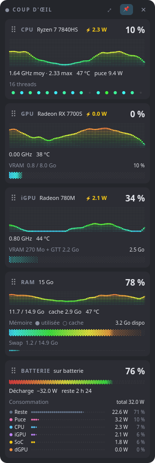
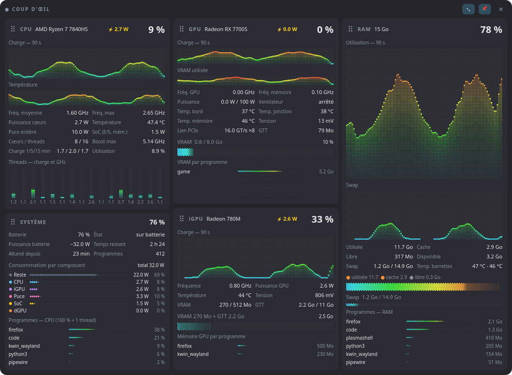

# Coup d'œil

Un petit moniteur système pour Linux, à garder dans un coin de l'écran : CPU, GPU,
iGPU, RAM et batterie en un coup d'œil, avec des graphiques en points qui défilent
en douceur.

<p align="center">
  
  &nbsp;&nbsp;
  
</p>

*Captures réalisées avec des données de démonstration.*

## Ce qu'il affiche

| Module | Vue compacte | Grande vue (bouton ⤢) |
|---|---|---|
| **CPU** | charge, fréquences, température, ⚡ watts des cœurs, un point par thread | température dans le temps, puce entière / SoC, charge moyenne, colonne par thread avec sa fréquence |
| **GPU / iGPU** | charge, fréquence, température, ⚡ watts, remplissage de la VRAM | fréquence mémoire, ventilateur, 3 températures, tension, lien PCIe, **VRAM par programme** |
| **RAM** | utilisée / cache / libre, swap, température des barrettes | historique RAM et swap, **programmes les plus gourmands** |
| **Batterie** | %, charge ou décharge en watts, temps restant, **consommation par composant** | idem dans la carte Système, avec les programmes les plus gourmands en CPU |

- **📌 Toujours au-dessus** des autres fenêtres.
- **Modules déplaçables** : attrape la poignée ⠿ à gauche d'un titre (dans la grande vue, d'une colonne à l'autre).
- **Fenêtre redimensionnable** par ses bords ; les courbes prennent l'espace en plus. Chaque vue retient sa taille, sa position et l'ordre de ses modules.
- **Consommation par composant** : classement trié (CPU, iGPU, SoC, reste de la puce, dGPU, et sur batterie le « reste du PC » — écran, RAM, SSD, Wi-Fi…).

## Matériel pris en charge

Pensé et testé sur un **Framework Laptop 16** (Ryzen 7 7840HS, Radeon 780M, Radeon RX 7700S) sous **CachyOS / KDE Plasma**.

- **CPU** : tout x86 Linux (charge, fréquences). Température via `k10temp` (AMD), puissance via RAPL.
- **GPU** : cartes **AMD** (pilote `amdgpu`). Les noms commerciaux viennent de la base de Mesa (`/usr/share/libdrm/amdgpu.ids`).
- **Puissance détaillée de la puce** (cœurs / iGPU / SoC) : APU AMD exposant `gpu_metrics` v2.x.
- **Température de la RAM** : barrettes DDR5 avec sonde `spd5118`.

Un capteur absent n'est pas une erreur : la valeur s'affiche « — ».

## Installation

Dépendances : **Python 3** et **PySide6** (sur Arch / CachyOS : `sudo pacman -S pyside6`).

```bash
git clone https://github.com/BiasedMonkey/coup-doeil.git
cd coup-doeil
./install.sh
```

Le script copie l'appli dans `~/.local/share/coup-doeil/`, ajoute l'icône et le lanceur
« Coup d'œil » au menu. Avec `./install.sh --favori`, il l'ajoute aussi aux favoris du
menu KDE.

Pour essayer sans installer : `python3 coup_doeil.py`.

## Bon à savoir

- **Wayland** : une application Wayland n'a le droit ni de se placer ni de rester au-dessus des autres. Coup d'œil passe donc par XWayland (`QT_QPA_PLATFORM=xcb`), où ces deux fonctions marchent.
- **Léger** : environ 2–3 % d'un cœur en vue compacte. Les capteurs restent ouverts et sont relus sans réouverture, chaque courbe n'est calculée qu'une fois par seconde, et l'animation ne fait que la faire glisser.
- **RAM « fantôme » des GPU** : quand un dGPU AMD se met en veille, le pilote recopie le contenu de sa VRAM dans la RAM. Un modèle d'IA local resté chargé peut ainsi occuper plusieurs Go de RAM sans apparaître dans les gestionnaires de tâches. La ligne « GTT » de la carte GPU (grande vue) le révèle.

## Vérifier

```bash
python3 tests/verifier.py
```

Teste sans écran, avec une configuration temporaire : déplacement des modules,
tailles retenues par vue, et stabilité de l'interface (aucun module ne doit changer
de taille quand la batterie, le GPU ou les valeurs changent).

## Outils

- `outils/galerie.py` : compare en direct plusieurs styles de graphiques en points (nécessite `psutil`).
- `outils/icones.py` : régénère les propositions d'icône dans `outils/icones/`.
